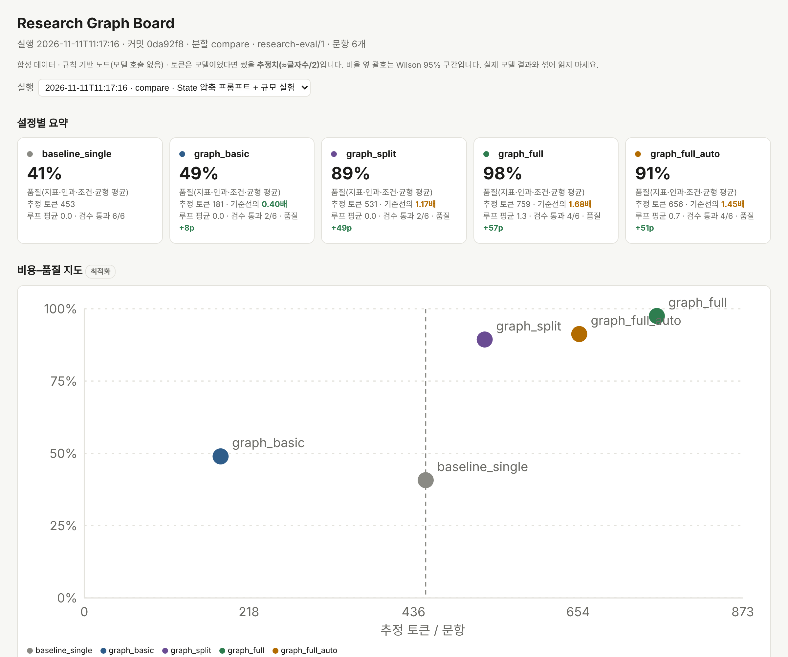

# langgraph-research-kit

> **상태: 개념과 계획 공개 (2026-11-14 갱신).** 공개 엔진은 이 레포에서 만듭니다: 맥락별 요약(vectorDB),
> 두 갈래 요약 검사기(벡터 유사도 ∥ 토큰 놀라움 점수 앵커), 실패 시 원문 추출 대체, 합성 예제.
> 도메인 규칙 팩, 도메인 필터, 보정한 문턱값, 실제 데이터는 비공개로 둡니다.

**평가 보드가 함께 딸린, 끼워 쓰는 LangGraph 리서치 모듈.**
AI가 바로 답하게 두지 않습니다. 모든 요청은 **분류 → 로컬 검색 → 규정 필터**를 거치고, 리서치 질문은
"전부 읽고 요약해" 한 번이 아니라 여러 전담 노드가 나눠서 처리합니다. 도메인마다 바뀌는 것은 필터 하나뿐이라,
같은 그래프를 리서치·법률·의료·로컬 행정에 쓸 수 있습니다.



## 왜

| 단일 호출 | 리서치 그래프 |
| --- | --- |
| 자료 전체를 한 번에 | 정제 → 개념 추출 → 찬반·조건 분리 탐색 → 상충 비교 → 작성 → 검수 |
| 자료가 길수록 중간이 흐려짐 | 주장·수치·관계를 State에 리듀서로 칸칸이 누적 |
| 출처가 섞임 | 모든 주장에 출처 id와 원문 위치(span)를 붙이고, 지어낸 인용은 버림 |
| 주류 의견 위주의 일반론 | 조건부 엣지로 반대 근거·한계를 따로 찾게 강제 |
| 일부가 부실하면 전부 다시 | 검수가 빠진 지표만 검색으로, 문장 문제만 작성으로 되돌림 |

## 바깥 레일: LangGraph 가드레일

모든 요청은 바깥 `StateGraph` 하나 안에서 돕니다. RAG나 리서치 파이프라인은 독립 노드 하나이고, 나머지는 엣지가 정합니다.

```text
START → classify ──research──→ rag ──route_by_cost_and_health──→ finish → END
           │                    ├──retry (일시 장애, max_loops 이내)──→ rag
           └──smalltalk──→ finish └──kill (반복 한도 / 비용 한도 / 노드 오류) → END
```

| 부분 | 역할 | 기본값 |
| --- | --- | --- |
| `classify` (제1관문) | 리서치/잡담 분류. 기본은 규칙 라우터, 구조화 출력 라우터는 마스킹된 텍스트만 봄 | 외부 전송 없음 |
| `rag` (메인 노드) | 파이프라인 그대로. 자체 입력 정책·마스킹·"근거 없으면 생성 0회" 유지 | — |
| `route_by_cost_and_health` (제2관문) | 순수 Python. 일시 장애만 재시도, 노드 오류·반복 한도·비용 한도면 중단 | `max_loops=3`, `max_cost=15` |
| `screen` / `verify` | 도메인 필터를 끼우면 추가되는 관문 | `max_verify_rounds=2` |

State에는 횟수와 코드만 담고 요청 원문·예외 메시지는 담지 않습니다. 모든 실행은 tracing 업로드 차단 안에서 돕니다.
현재 코드: 원 레포의 `rag/guardrail_graph.py`.

## 구조

```text
분류 → 입력 필터 → 계획 → 검색(기본|찬성|반대|조건) → 정제 → 추출 → 비교 → 빈칸 확인 ⇄ 표적 재검색
     → 작성 → 검수 ⇄ 재작성 → 끝 (예산 소진 시 부분 보고서 + "검수 미통과 항목")
모든 엣지 공통: 반복 한도, 비용 한도, 노드 오류 → 중단
```

- **RAG 앞뒤 두 관문:** `screen`이 검색 전에 막거나 분기하고, `verify`가 답변을 검수합니다. 고칠 수 있으면 예산 안에서
  다시 만들고, 끝내 통과하지 못한 글은 내보내지 않습니다.
- **State는 금고:** 출처·주장·수치·관계를 덮어쓰지 않고 쌓습니다. 로그에는 코드만 남깁니다.
- **비용을 직접 잽니다:** 노드마다 모델 토큰 추정치를 기록하고, 작성 노드는 원문이 아니라 주장 표만 봅니다. 토큰 상한을
  넘으면 루프를 멈춥니다.

## 도메인 필터 (교체형)

| 도메인 | 주된 환각 | 필터 초점 | 상태 |
| --- | --- | --- | --- |
| 리서치 | 인과 유실, 피상적 일반화, 출처 없는 수치 | 온톨로지 추출, 원문 대조 루프, 밀도 | 규칙 기반 v1 |
| 법률 | 시차 뒤섞임, 없는·폐지된 조항 인용 | 시차 리듀서, 검증된 조항 DB, 사건 유형 격리 | 뼈대 개발 중 |
| 의료 | 진단 단정, 금기 약물 누락 | 응급 분류, 가이드라인 근거, 면책 | 뼈대 개발 중 |
| 로컬 행정 | 지역 예외 무시, 구버전 양식 | 관할 분기, 최신 규정 DB, 서류 체크리스트 | 예정 |

안전 지표(예: 단정 진단 수)는 품질 점수와 섞지 않고 따로 보여 줍니다.

## 평가 보드

보드는 상품 구성품입니다. 그래프를 보면서 조정합니다. 설정별 비교, 비용–품질 지도, 자료 규모별 손익분기, 문항별 보고서와
노드 경로, 실행 기록(Wilson 95% 구간), 손잡이 슬라이더(다음 단계)를 제공합니다.

첫 측정(합성, 규칙 기반, 토큰 추정치, 기준선은 LLM이 아니라 "문서 첫 문장 요약"):

| | 단일 호출 기준선 | 리서치 그래프 |
| --- | --- | --- |
| 품질, 비교용 6문항 | 41% | 97% |
| 품질, 검증용 3문항(1회 실행) | 32% | 96% |
| 추정 토큰, 배경 문서 +0 / +10 / +60 | 452 / 1,788 / 8,438 | 759 / 1,324 / 1,405 |

작은 합성 표본이라 경향일 뿐 증명은 아닙니다. 실제 모델 비교는 아직 하지 않았습니다.

## 로드맵

1. 공개 엔진을 이 레포에서 (2026-11-14 변경): 맥락별 요약 + 두 갈래 검사기 + 원문 추출 대체. 도메인 팩과 보정값은 비공개.
2. 같은 자리에 모델 노드: 로컬 모델로 계획·추출·작성 구조화 출력. 외부 모델은 마스킹 후, 허용한 경우에만.
3. 도메인 팩: 법률·의료 필터와 각자의 합성 문항·안전 지표, 이어서 로컬 행정.
4. 보드에 실제 모델 기준선: 같은 문항, 같은 토큰 계산으로 단일 요약과 그래프 비교.
5. 계측 보드: 실행 궤적·비용·환각 방어·레이턴시 4패널을 하나의 이벤트 스키마로, [설계](docs/METRICS_BOARD.ko.md).
6. LangGraph 기능 실험: 병렬 분기(`Send`), 체크포인트·사람 확인(`interrupt`), 도메인별 서브그래프.

## 원칙

로컬 우선, 서비스 코드에서 tracing 업로드 없음, 이 레포에는 합성 데이터만, 규칙은 모두 버전 관리, 주장은 측정으로.

## 설계 노트

- 필터 설계 브레인스토밍: [한국어](docs/brainstorm/FILTER_BRAINSTORM.ko.md) · [English](docs/brainstorm/FILTER_BRAINSTORM.en.md) · [PDF, 다크](docs/brainstorm/FILTER_BRAINSTORM_dark.pdf)
- 계측 보드(4대 지표 + 이벤트 스키마): [한국어](docs/METRICS_BOARD.ko.md) · [English](docs/METRICS_BOARD.en.md)
- 이전 계획: [docs/MIGRATION_PLAN.md](docs/MIGRATION_PLAN.md)
