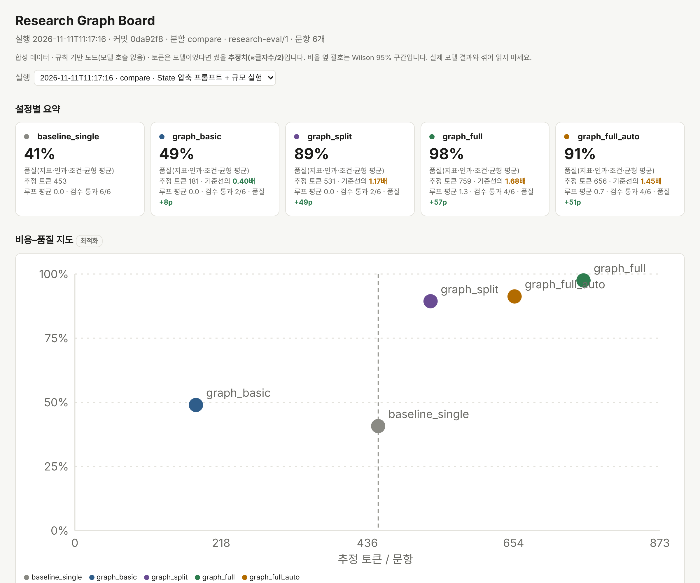

# langgraph-research-kit

> **Status: draft.** The code is moving here from
> [langchain-rag-research-agent](https://github.com/ai-agent-orchestrator/langchain-rag-research-agent) (planned 2026-11-12).
> This README describes the concept and the parts that already run there.

**A pluggable LangGraph research module with its own evaluation board.**
It never lets a model answer straight away: every request goes **route → local retrieval → rule filter**, and research
questions are split across specialised nodes instead of one "summarise everything" call. The filter is the only
domain-specific part, so the same graph can serve research, legal, medical or local-administration work.

[한국어 README](README.ko.md)



## Why

One model call over a pile of documents blurs the middle, drops conditions and exceptions, mixes up which number came
from which source, and drifts toward the most common opinion. Making the model bigger does not fix the path the
information travels. This kit fixes the path:

| Single call | Research graph |
| --- | --- |
| one pass over everything | refine → extract concepts → split pro / con / limits → compare → write → verify |
| context blurs as input grows | claims, metrics and relations accumulate in State through reducers |
| sources get mixed up | every claim carries its source id and character span; invented quotes are dropped |
| mainstream, generic conclusion | conditional edges force a separate search for counter-evidence and limits |
| weak part → rerun everything | the verifier sends only the missing metric back to retrieval, or only the prose back to the writer |

## The outer rail: LangGraph guardrail

Every request runs inside one outer `StateGraph`. The RAG or research pipeline is a single isolated node; the edges decide
everything else.

```text
START → classify ──research──→ rag ──route_by_cost_and_health──→ finish → END
           │                    ├──retry (transient failure, ≤ max_loops)──→ rag
           └──smalltalk──→ finish └──kill (loop limit / cost limit / node error) → END
```

| Part | Role | Default |
| --- | --- | --- |
| `classify` (gate 1) | research or small talk; rule router by default, structured-output router on masked text only | no network |
| `rag` (main node) | the pipeline, untouched; its own input policy, masking and "no evidence = no generation" rule still run | — |
| `route_by_cost_and_health` (gate 2) | pure Python: retry only transient failures, kill on node error, loop limit or cost limit | `max_loops=3`, `max_cost=15` |
| `screen` / `verify` | domain filter gates added when a `DomainFilter` is plugged in | `max_verify_rounds=2` |

State holds counters and codes, never request text or exception messages; every run is wrapped in a no-upload tracing
guard. Code today: `rag/guardrail_graph.py` in the source repo.

## How it works

```text
START → classify ─smalltalk→ finish
           │ research
           ▼
        screen (domain input filter) ──blocked──→ finish
           ▼
         plan ─→ retrieve: base | pro | con | limits ─→ refine ─→ extract ─→ compare
                                                                               │
                         retrieve_gap (missing metric only) ⇄ coverage ◀───────┘
                                                                │ complete
                                                                ▼
                                                              write ─→ verify ──pass──→ finish
                                                                ▲         │
                                                                └─rewrite─┘   budget spent → partial report + "not verified" list
   every edge: loop limit, cost limit, node error → kill
```

- **Two gates around the RAG node.** `screen` blocks or routes input before retrieval; `verify` checks the answer after
  it. Fixable problems regenerate inside the loop and cost budget; text that keeps failing is never returned.
- **State is a vault, not a scratchpad.** Sources, claims, metrics and relations are appended, never overwritten. Logs
  hold codes only (`VERIFY:FAIL:CAUSAL_LOSS`), never request text.
- **Cost is a first-class signal.** Each node records the tokens a model call would use. The writer sees a compact
  claims table, not raw documents. A token cap stops loops before they run away.

## Domain filters (swappable)

```python
class DomainFilter(Protocol):
    name: str; version: str
    def check_input(self, text) -> InputDecision          # allowed, code, branch
    def verify(self, answer, evidence, branch) -> Verdict  # issue codes, retryable or not
    def finalize(self, answer, branch) -> str              # notices, disclaimers
```

| Domain | Typical hallucination | Filter focus | Status |
| --- | --- | --- | --- |
| Research | lost causality, shallow generalisation, numbers without a source | ontology extraction, source check loop, density | rule-based v1 |
| Legal | mixed-up timelines, repealed or non-existent articles | timeline reducer, verified statute DB, case-type isolation | skeleton in progress |
| Medical | definitive diagnoses, missing contraindications | emergency triage, guideline mapping, disclaimer | skeleton in progress |
| Local administration | regional exceptions ignored, outdated forms | jurisdiction branch, latest-rule DB, document checklist | planned |

Safety metrics (for example "definitive diagnoses") are reported **separately from quality** and never averaged away.

## Evaluation board

The board is part of the product: tune the graph by watching it.

- **Configs side by side:** quality (metrics, causality, conditions, balance), estimated tokens, loops, verifier pass rate.
- **Cost–quality map:** top-left is the goal; the dashed line is the single-call baseline.
- **Break-even by corpus size:** loops cost more on small inputs; retrieval wins as the corpus grows.
- **Per-case drill-down:** the generated report, what is missing, the node path.
- **Run history:** every run is appended, so changes show up as a trend. Ratios carry Wilson 95% intervals.
- **Knobs (next):** pre-computed grids behind sliders (`k`, rewrite limit, gap-search limit, checklist on/off).

First measurement, synthetic and rule-based (no model calls; tokens are estimates; the baseline is "first sentence of
each document", not an LLM):

| | single-pass baseline | research graph |
| --- | --- | --- |
| quality, compare set (6 cases) | 41% | 97% |
| quality, confirm set (3 cases, run once) | 32% | 96% |
| est. tokens with +0 / +10 / +60 background docs | 452 / 1,788 / 8,438 | 759 / 1,324 / 1,405 |

Small synthetic samples: tendencies, not proof. The real-model comparison has not been run yet.

## Using it elsewhere (planned API)

```python
from langgraph_research_kit import run_research, keyword_search, get_filter

result = run_research(
    "How did the rate rise affect housing transactions?",
    search=keyword_search({"d1": "...", "d2": "..."}),   # or a Chroma adapter
    checklist=("house prices",),
    domain="research",                                   # or "legal", "medical", ...
)
print(result.report, result.verify_codes, result.shadow_tokens)
```

## Roadmap

1. Move the code with history; package as `langgraph_research_kit`; tests and board run from this repo alone.
2. Model nodes behind the same slots: structured-output plan / extract / write with a local model; outside models only on masked text and only if allowed.
3. Domain packs: legal and medical filters with their own synthetic cases and safety metrics; local administration next.
4. Real-model baseline on the board: one-shot summary vs the graph, same cases, same token accounting.
5. LangGraph features as experiments: parallel branches (`Send`), checkpoints and human review (`interrupt`), subgraphs per domain.

## Principles

Local first, no tracing uploads from serving code, synthetic data only in this repository, every rule versioned,
claims measured rather than asserted.

## Design notes

- Filter design brainstorm: [English](docs/brainstorm/FILTER_BRAINSTORM.en.md) · [한국어](docs/brainstorm/FILTER_BRAINSTORM.ko.md) · [PDF, dark](docs/brainstorm/FILTER_BRAINSTORM_dark.pdf)
- Migration plan: [docs/MIGRATION_PLAN.md](docs/MIGRATION_PLAN.md)
